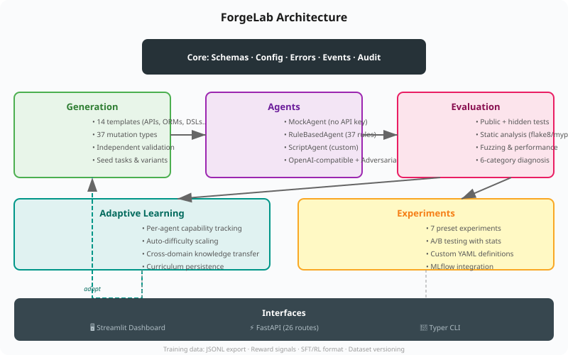
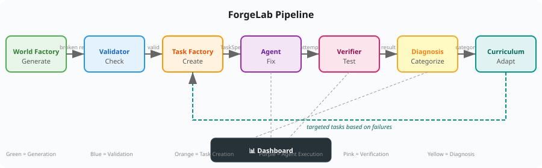

# ForgeLab

A research platform for testing and improving autonomous coding agents.

ForgeLab creates broken code repositories, runs AI agents against them, checks if the fixes actually work, figures out why they failed when they do, then uses those insights to generate better training tasks. The whole loop runs automatically.

## The Problem

Most coding agent benchmarks use static task sets. Agents memorize them. Researchers can't tell if a failure is the agent's fault or a bad task. And there's no way to automatically generate harder challenges based on what an agent struggles with.

ForgeLab addresses three gaps:

1. **Can we generate valid coding tasks programmatically?** — Yes, via template-based world generation with independent validation.
2. **Can we tell why an agent failed?** — Yes, via a 6-category failure attribution engine that distinguishes agent bugs from task bugs from environment issues.
3. **Can we use those failures to improve training?** — Yes, via adaptive curriculum that tracks capability scores and generates targeted tasks.

## How It Compares

| Project | What They Do | What ForgeLab Adds |
|---|---|---|
| [Echoverse](https://github.com/microsoft/Echoverse) | Stateful computer-use environments | Terminal-based code repair environments |
| [Orchard-Agentic](https://microsoft.github.io/Orchard-Agentic/) | Auto-scaling from agent rollouts | Validation-first generation with failure attribution |
| [Agent Lightning](https://github.com/microsoft/agent-lightning) | RL training for coding agents | Portable eval layer that works with any agent |

## Quick Start

```bash
# Install
cd forgelab
pip install -e .

# Check system
python -m forge.cli doctor

# Run end-to-end demo (no API keys required)
python examples/demo_pipeline.py

# Start API server
python -m uvicorn forge.api.app:app --reload --port 8000

# Start dashboard
streamlit run dashboard/app.py
```

## Architecture



```
forge/
├── core/           # Schemas, config, errors, events
├── world_factory/  # Template-based broken repo generation
├── task_factory/   # Task spec creation and seed loading
├── validators/     # Independent validation
├── agents/         # Pluggable agents (4 built-in types)
├── runner/         # Run orchestration and trajectory recording
├── evaluation/     # Test verification and analysis
├── diagnosis/      # Failure attribution (6 categories)
├── curriculum/     # Adaptive task selection
├── experiments/    # Experiment management and stats
├── sandbox/        # Isolated execution (Docker + local fallback)
├── training/       # Trajectory export, rewards, data curation
├── api/            # FastAPI REST backend
├── db/             # SQLAlchemy models (SQLite)
└── cli.py          # Command-line interface
```

## The Pipeline



Each step is independent. Worlds are validated before agents see them. Fixes are verified separately from the agent. Failures are categorized so you know whether the agent, task, or environment was at fault.

## In Action

### Overview Dashboard

The main dashboard shows real-time metrics from all runs. Five metric cards display worlds generated, tasks created, total runs, passes, and currently-running agents. Below that, a pass/fail bar chart and a failure attribution pie chart break down results by category (agent failure, environment failure, task failure, etc.). A recent runs table shows the last 10 executions with status, duration, and pass/fail indicators.

**What you see:** At-a-glance health of your entire experiment. Green bars mean agents are fixing bugs. Red slices in the pie chart tell you what's going wrong and why.

### Worlds Page

Lists all generated broken repositories with their template name, mutation type, seed value, and creation timestamp. Each world is a self-contained Python repository with a specific bug injected — for example, `task_manager_api` with a `pagination_boundary` mutation means the pagination logic returns wrong results at edge cases.

**What you see:** Every broken repo ForgeLab created, organized by when it was generated. Click through to see the actual code and the bug that was injected.

### Tasks Page

Shows all tasks derived from worlds, including task ID, world reference, category, difficulty level (1-5), validation status, and description. The "Show validated only" filter lets you hide tasks that haven't passed independent validation.

**What you see:** The actual coding challenges agents will face. Each task describes what's broken and what needs to be fixed, with difficulty ratings that auto-adjust based on agent performance.

### Runs Page

The most detailed view. Filter by agent type, status, pass/fail, or search by task/run ID. Each run expands to show task details, agent used, duration, step count, and error messages. The trajectory timeline shows every tool call the agent made — file reads, edits, test runs — with timing and success/failure status. Code diff viewer shows side-by-side comparison of original vs. agent-modified code. Export buttons download results as JSON or CSV.

**What you see:** Every agent execution in detail. You can see exactly what the agent did, step by step, and whether it actually fixed the bug or made things worse.

### Failure Analysis Page

Pie chart showing the distribution of failure categories. Expandable sections group failures by type — agent failure (the agent wrote wrong code), environment failure (Docker/sandbox issues), task failure (the task itself was invalid), verifier failure (tests couldn't run), infrastructure failure (system resources), and unknown. Each failure includes confidence scores and evidence.

**What you see:** Why things failed. This is the core research value — knowing whether a failure is the agent's fault or a problem with the task or environment.

### Curriculum Page

Shows the adaptive curriculum state: per-agent capability scores across different task categories, difficulty levels, and selected tasks. The curriculum tracks which tasks each agent has seen, how it performed, and automatically adjusts difficulty. Cross-domain knowledge transfer shows how performance in one area affects task selection in another.

**What you see:** How the system learns. Agents that struggle with null handling get more null handling tasks. Agents that excel get harder challenges. The curriculum adapts in real-time.

### Experiments Page

Lists all experiments — both preset (A-D, ablation studies, difficulty scaling, cross-template) and custom YAML-defined experiments. Shows experiment status, agent types, task counts, and results. A/B test comparison shows side-by-side agent performance with statistical significance testing.

**What you see:** Structured research experiments. Compare two agents on the same tasks, measure tool importance through ablation, or test how agents scale across difficulty levels.

## What's Included

**Environments:** 14 templates covering common patterns — APIs, data pipelines, web apps, ORMs, config systems, DSLs, browser automation, and more. 37 mutation types inject realistic bugs: null handling, SQL injection, CSRF, rate limiting, XSS, transaction leaks, and others.

**Agents:** Six built-in agent types. `MockAgent` for testing without API keys. `RuleBasedAgent` with pre-built repair rules for all 37 mutation types. `ScriptAgent` for running your own Python scripts. `OpenAI-compatible` agent with tool calling. `ClaudeAgent` for Anthropic's Claude API. `OpenSourceAgent` for local models via Ollama/vLLM. Plus an adversarial wrapper for stress testing. All agents degrade gracefully when their external service is unavailable.

**Evaluation:** Independent test verification (public + hidden tests), static analysis (flake8/mypy), fuzzing-based edge case testing, performance regression detection, and code diff viewing.

**Failure Diagnosis:** 6-category attribution engine — agent failure, environment failure, task failure, verifier failure, infrastructure failure, or uncertain. Each diagnosis includes evidence.

**Curriculum:** Adaptive task selection that tracks per-agent capability scores, auto-adjusts difficulty, supports cross-domain knowledge transfer, and persists state between sessions.

**Experiments:** 7 preset experiments (ablation studies, difficulty scaling, cross-template generalization, etc.), A/B testing with statistical significance, custom YAML-based experiment definitions, and MLflow integration.

**Interfaces:** FastAPI backend (26 routes), Streamlit dashboard with filtering and charts, and a full Typer CLI.

**Training Data:** Normalized trajectory export (JSONL), difficulty-weighted reward signals, positive/negative example curation, SFT and RL format export, and dataset versioning.

**Training Integration:** Hugging Face TRL for SFT/DPO fine-tuning, GRPO for reinforcement learning, Microsoft Agent Lightning for distributed execution. All degrade gracefully when ML frameworks aren't installed.

**Security:** Docker sandbox isolation, network policies, container image signing, and automated security audits.

## CLI

```bash
forgelab init                          # Set up database and directories
forgelab doctor                        # Check system health
forgelab world generate                # Generate a broken repo
forgelab run --task-id X               # Run an agent on a task
forgelab benchmark run --agent mock    # Evaluate an agent
forgelab experiment run --preset A     # Run a preset experiment
forgelab export --format json          # Export run data
forgelab serve                         # Start the API server
forgelab --help                        # See all commands
```

## Deploy to Vercel

ForgeLab deploys to Vercel as serverless Python functions with an interactive dashboard frontend:

```bash
# Install Vercel CLI
npm i -g vercel

# Login and deploy
vercel login
vercel --prod
```

**Live demo:** The landing page shows real-time API health, template/mutation counts, and interactive world generation. All API endpoints are tested and verified.

### Vercel API Endpoints (Verified ✓)

All 11 Vercel API tests pass locally. 71 core/integration tests pass with zero regressions.

| Endpoint | Method | Description |
|---|---|---|
| `/health` | GET | Health check with version and environment |
| `/` | GET | Landing page with interactive dashboard |
| `/api/v1/templates` | GET | List all 14 templates |
| `/api/v1/mutations` | GET | List all 37 mutations |
| `/api/v1/worlds/generate` | POST | Generate a broken repo from template |
| `/api/v1/experiments` | GET | List 7 preset experiments |
| `/api/v1/benchmark` | GET | Benchmark info (templates, mutations, agents) |
| `/api/v1/docs` | GET | API documentation |
| `/openapi.json` | GET | OpenAPI schema |
| `/docs` | GET | Swagger UI docs |
| Unknown routes | — | Returns 404 |

Run `python -m pytest tests/test_vercel.py -v` to verify locally before deploying.

### What's on Vercel

- **Interactive dashboard** — dark-themed frontend with live API connection
- **World generator** — pick a template and mutation, generate a broken repo
- **API explorer** — browse all endpoints with live responses
- **Template/mutation browser** — see all 14 templates and 37 mutations

### What requires local setup

- Streamlit dashboard (`streamlit run dashboard/app.py`)
- Long-running agent executions (`forgelab run --task-id X`)
- Database persistence (Vercel uses ephemeral `/tmp` storage)

## Configuration

Environment variables:

| Variable | Default | Description |
|---|---|---|
| `FORGELAB_DB` | `forgelab.db` | Database path |
| `FORGELAB_PROVIDER` | `mock` | Agent provider (mock/openai) |
| `FORGELAB_API_KEY` | | API key for LLM agents |
| `FORGELAB_MODEL` | | Model identifier |
| `FORGELAB_MAX_STEPS` | `50` | Max tool-call steps per run |

## Testing

```bash
pytest tests/ -v
```

82+ tests covering Vercel API endpoints, core schemas, world generation, mutations, validation, agents, runner, evaluation, diagnosis, curriculum, experiments, sandbox, training adapter, Alembic migrations, seed task loader, and integration tests. The full suite runs in ~15 seconds.

## Limitations

- **Docker required for hidden tests.** Without a Docker daemon, the verifier can't run hidden test suites in isolation. Runs are marked as `environment_failure` — the safe default.
- **OpenAI agent needs an API key.** Install `openai` and set `FORGELAB_API_KEY`. Without it, use MockAgent or RuleBasedAgent.
- **No model training yet.** The training adapter exports data and computes rewards, but actual RL training (GRPO/PPO) isn't implemented. The interface is ready for it.

## What's Next

- Docker-based verifier for production hidden test execution
- GRPO/PPO training adapter integration
- MLflow/W&B experiment tracking

For the full roadmap see [ROADMAP.md](docs/ROADMAP.md).

## Research References

1. [Microsoft Echoverse](https://github.com/microsoft/Echoverse) — Environment construction and grounded evaluation
2. [Orchard-Agentic](https://microsoft.github.io/Orchard-Agentic/) — AutoEnvScaling and Self-HPO
3. [Agent Lightning](https://github.com/microsoft/agent-lightning) — RL for coding agents
4. [Hugging Face TRL](https://github.com/huggingface/trl) — RL training library

## License

MIT
